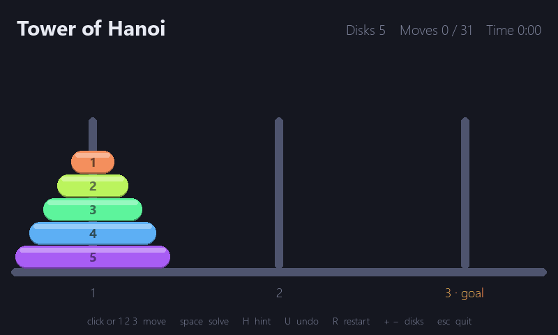

<div align="center">

# 🗼 honoi

**The Tower of Hanoi as a desktop game, with an animated solver that finishes from any position.**

Move the whole tower to the goal peg, one disk at a time, never putting a
larger disk on a smaller one. Drag disks with the mouse or use the keyboard,
take moves back, ask for a hint, or let the computer finish the puzzle in the
fewest possible moves.

[](https://github.com/mredwardlik/honoi/actions/workflows/tests.yml)




</div>

---

## ✨ Features

- 🖱 **Mouse and keyboard**: drag a disk to another peg, click one peg and then
  another, or press `1` `2` `3`
- 🤖 **Solver from any position**: press `Space` in the middle of a game and
  the computer finishes in the fewest possible moves, not by starting over.
  Change its speed with `←` `→`, pause it with `Space`
- 💡 **Hints**: `H` highlights the next move of the shortest solution
- ↩️ **Undo**: `U`, `Backspace` or `Ctrl+Z`, as many moves back as you like
- 📊 **Score**: moves against the minimum `2ⁿ − 1` and a timer. A solution in
  the minimum number of moves is marked as perfect
- 🎚 **1 to 10 disks**: `+` and `−` change the level, `N` goes to the next one
  after a win
- 🪟 **Resizable window**: the layout scales to any size from 640×420

## 🚀 Installation

```bash
pip install git+https://github.com/mredwardlik/honoi.git
honoi
```

Python 3.10 or newer. The only dependency is
[pygame-ce](https://pyga.me). From a clone, run `python -m honoi`.

```bash
honoi --disks 6            # start with 6 disks
honoi --disks 8 --solve    # watch the solver from the first move
honoi --size 1280x720      # a bigger window
```

## 🎮 Controls

| Key                          | Action                                         |
| ---------------------------- | ---------------------------------------------- |
| mouse, `1` `2` `3`           | pick up the top disk of a peg, put it down     |
| `Space`                      | start or pause the solver                      |
| `←` `→`                      | solver speed, from ×0.5 to ×32                 |
| `H`                          | hint: the next move of the shortest solution   |
| `U`, `Backspace`, `Ctrl+Z`   | undo                                           |
| `R`                          | restart                                        |
| `+` `−`                      | more or fewer disks                            |
| `N`                          | next level after a win                         |
| `Esc`                        | put the disk back, or quit                     |

## 🧠 How the solver works

The classic recursion carries a tower of `n` disks from peg `A` to peg `C` in
`2ⁿ − 1` moves: move `n − 1` disks to `B`, the largest disk to `C`, then the
`n − 1` disks from `B` onto it.

The game needs more than that, because the solver can start from any position
the player left. It looks at the disks from the largest one down:

- if the disk is already on the target peg, it stays, and the smaller disks
  go to the same target;
- otherwise all smaller disks go to the third peg, the disk moves to the
  target, and the smaller disks follow it.

This gives the shortest solution from every legal position. The tests check
it against a breadth-first search over all `3ⁿ` positions for up to five disks.

```python
from honoi import Towers, classic_solution, solution_from

classic_solution(3)       # [(0, 2), (0, 1), (2, 1), (0, 2), (1, 0), (1, 2), (0, 2)]
solution_from([[3], [2, 1], []])  # [(0, 2), (1, 0), (1, 2), (0, 2)]

towers = Towers(4)        # all disks on peg 0, the goal is peg 2
towers.move(0, 1)         # returns the disk: 1
towers.hint()             # (0, 2)
towers.undo()             # (0, 1)
towers.minimum            # 15
```

Pegs are numbered from 0 in the code and from 1 in the game. A wrong move
raises `IllegalMove` with the reason.

## 🗂 Project structure

```text
honoi/
├── honoi/
│   ├── towers.py   # rules, undo, classic and any-position solutions (no pygame)
│   ├── game.py     # window, drawing, input, animations, solver, confetti
│   └── cli.py      # the honoi command
├── tests/          # pytest: rules, optimality, the game driven headless
└── docs/demo.gif
```

## 🧪 Tests

```bash
pip install -e ".[dev]"
pytest
```

The game tests run without a screen through SDL's dummy video driver. They
press keys, drag disks and let the solver finish.
